# Tavanfroosh security, performance and UI/UX report

Branch `security/red-blue-hardening`. Date 2026-10-15. Scope: `backend/`, `frontend/`, Docker, dependencies.

## 1. Outcome

All 19 items from the first review and all 25 confirmed items from the independent audit are fixed or mitigated, except where §8 says otherwise. The local pen test went from 13 of 14 attacks succeeding to 0 of 51 checks failing. The analytics query is about 22× faster uncached, and the library list is about 90× faster. Every security fix ships with its performance effect noted.

## 2. Method

| Step | What ran |
|---|---|
| Recon and manual review | Every source file, Dockerfiles, compose, dependency trees (`HANDOFF.md` §4-5). |
| Independent audit | A workflow of 5 read-only auditors (authz/logic, input and resources, frontend, infra and supply chain, performance) on the baseline commit, then 5 adversarial verifiers told to refute each finding. Result: 25 confirmed, 8 rejected. Raw output: `handoff/audit-workflow-findings.json`. |
| SAST and SCA | Manual Bandit/Semgrep-class review of sinks (SQL, file paths, headers, `dangerouslySetInnerHTML`). `npm audit`, plus the installed versions checked against advisories. |
| Pen test before | Original code on a scratch DB: `handoff/pentest-baseline.txt`. |
| Pen test after | `backend/test_security.py` boots the hardened API on a temp DB and runs 51 attacks or assertions. |
| Performance | The same 100k-event, 100-item database served by both versions. |
| UI/UX | `apple-design` (WWDC *Designing Fluid Interfaces*, typography, accessibility). |
| Simplicity | `ponytail` and `ponytail-review` on the final diff (§7). |
| Map | `graphify` knowledge graph of the final tree (§9). |

All attack traffic targeted local scratch servers. `backend/data` was never touched.

## 3. Attack tree (red team)

Root goal: leak the sales library, or put unapproved or malicious material in front of customers. Leaves show the state before the fix, then the control that now blocks them.

```mermaid
graph TD
  R[Leak library or mislead customers] --> A[Read internal content]
  R --> B[Push unapproved or malicious content]
  R --> C[Poison analytics]
  R --> D[Deny service]
  R --> E[Take over an account]
  R --> F[Supply chain]
  A --> A1[Anonymous GET list/item/file<br/>was: trivial, no auth<br/>now: session required]
  A --> A2[Reuse id from a share link<br/>was: id = primary key, listed publicly<br/>now: 128-bit revocable token, item only]
  A --> A3[Steal session via XSS<br/>now: HttpOnly cookie, nonce CSP, no inline uploads]
  B --> B1[Self-approve<br/>was: anyone<br/>now: admin role only]
  B --> B2[Share or download a pending item<br/>was: allowed<br/>now: 409]
  B --> B3[Upload .html/.svg, served inline<br/>was: stored XSS<br/>now: allow-list + magic bytes + attachment + sandbox]
  B --> B4[Drive-by CSRF from an employee browser<br/>was: simple POSTs accepted<br/>now: Sec-Fetch-Site block + SameSite=Strict]
  C --> C1[POST fake view/share events<br/>was: 50/50 accepted<br/>now: route removed, server records, deduped]
  D --> D1[Huge body or chunked upload<br/>now: 413 before parsing]
  D --> D2[Multi-range header, Starlette CVE-2025-62727<br/>now: Starlette 1.7.0]
  D --> D3[Hammer the expensive analytics/list<br/>now: auth + indexes + 30 s cache]
  D --> D4[Flood login or demo form<br/>now: per-user/IP + global limits]
  E --> E1[Brute force a known user<br/>now: scrypt + 10/5 min per username]
  E --> E2[Enumerate users by timing<br/>now: dummy hash for unknown users]
  F --> F1[Floating pins, vulnerable next/sharp/starlette<br/>now: hash lock, exact pins, image digests]
```



MITRE ATT&CK and OWASP API mapping for the main paths: T1190 Exploit Public-Facing Application (A1, B1, B3), T1213 Data from Information Repositories (A1, A2), T1189 Drive-by Compromise (B4), T1110 Brute Force (E1), T1499 Endpoint DoS (D1-D4), T1195 Supply Chain Compromise (F1); OWASP API1 BOLA, API2 Broken Auth, API4 Resource Consumption, API5 BFLA, API6 Sensitive Business Flows, API8 Misconfiguration.

## 4. Findings and fixes (blue team, with performance tie-in)

Severity is for a public deployment. "Verified" means a check in `backend/test_security.py` or a measured number.

### Access control and business logic

| ID | Sev | Attack (red) | Fix (blue) | Performance | Verified |
|---|---|---|---|---|---|
| SEC-1 | Critical | Anyone could approve, delete, upload and read analytics. | `/api/login` with scrypt hashes from `AUTH_USERS`. HMAC-signed `sid` cookie: HttpOnly, Secure, SameSite=Strict, Path=/api, 8 h. Roles `rep` and `admin`, role read from config, not the cookie. | Auth is one HMAC per request. Gating analytics removes the cheapest anonymous DoS. | 401/403 checks, tampered and expired cookies |
| Audit #0 | Medium | Pending items could still be shared and downloaded. | Share and download require `approved` (admins may open pending). The UI hides Share, Approve, Delete and Revoke by role. | Uses the row already loaded. | 409 checks |
| Audit #1, SEC-2 | Medium | Share links were the internal `/library?c=<id>`, permanent and listed to anyone. | `shares` table with `secrets.token_urlsafe(16)` tokens. Public `/api/s/<token>` shows that item only, and only while it is approved. Admins can revoke. New page `/s/[token]`. | One primary-key lookup per open. | link, re-pend, re-approve, revoke checks |
| Audit #2 | Medium | Cross-site forms or no-cors fetches could drive writes. | Edge guard rejects non-GET with `Sec-Fetch-Site` other than same-origin/none. SameSite=Strict cookie. CORS removed. | Rejected before routing. | cross-site 403 check |
| Audit #3/#9 | Low | Concurrent "new version" calls reused version numbers. | `version=version+1` and `INSERT…SELECT` in one write transaction, plus a unique index. Old duplicates are deduped at startup. | One fewer read. | 10 concurrent writes give 1…12 |
| Audit #4/#11 | Low | Views were never recorded. Shares were counted even when nothing was shared. | A view is recorded on the server when a share link is opened, once per IP per 30 min. A share is now "link created" on the server. The clipboard fallback is a copy prompt. The client event route is deleted. | Removes one client round trip per share. | reload counts one view |
| Audit #5 | Low | Every fresh production DB got fake demo data. | Seed only with `SEED_DEMO=1`. | Faster first start. | n/a |

### Input handling and uploads

| ID | Sev | Attack | Fix | Performance | Verified |
|---|---|---|---|---|---|
| SEC-3 | High | An `.html` upload was served as `text/html`: stored XSS on the app origin. | Allow-list by extension and magic bytes (PDF, OOXML, MP4, PNG, JPEG, WebP). Served with a pinned type, `attachment`, `nosniff`, and `sandbox` CSP. Legacy files are served as `application/octet-stream`. | Checks 16 bytes. | .html, .svg, disguised .pdf all get 415 |
| SEC-4 | Medium | A title with CRLF went into Content-Disposition. | Filename sanitized server-side. | — | CRLF check |
| SEC-6, audit #7/#19 | Medium | Bodies were spooled whole before the 50 MB check. The handler then read the file into RAM. | Pure-ASGI guard: 413 on Content-Length, and a streaming byte cap for chunked bodies. Upload is copied to disk in 1 MB chunks. | Oversized requests cost almost nothing now. | both 413 checks |
| Audit #10/#14 | Medium | Next's `/api` rewrite truncates bodies at 10 MB, so 10-50 MB uploads always failed. | One limit everywhere: 10 MB backend, `proxyClientMaxBodySize: 11mb`, client pre-check with a clear message. | Caps Node memory per upload. | — |
| Audit #8/#18 | Medium | `async` upload handler did blocking disk and sqlite work on the event loop. | Plain `def`, which runs in the threadpool. | Other requests no longer stall during uploads. | — |
| SEC-12 | Low | `?c=` not URL-encoded. | `encodeURIComponent`. | — | — |
| — | Info | SQL injection and path traversal probes. | Already parameterized. Ids are now validated by regex, new ids are 128-bit, `q` is capped at 100 chars. | — | probes return 200/404/422, never 500 |

### Abuse and DoS

| ID | Sev | Attack | Fix | Performance | Verified |
|---|---|---|---|---|---|
| SEC-5 | Medium | No rate limits. | Sliding-window limiter: login 20/5 min per IP **and** 10/5 min per username; demo 5/h per IP plus 300/h global; upload 30/h per user; share 60/min per user; public links 120/min per IP. Memory is bounded. | O(1) per check. | brute-force and flood 429 checks |
| Audit #17 | Info | Next keeps a client-sent `X-Forwarded-For`, so IP keys are spoofable. | Limits that matter are keyed on user or username. Uvicorn trusts forwarded headers only from the private compose network. | — | — |
| Audit #6/#12 | High | Starlette 0.46 Range-header O(n²) DoS (CVE-2025-62727) and multipart rollover (CVE-2025-54121). | FastAPI 0.141.1 with Starlette 1.7.0 and an explicit `starlette>=0.49.1` floor. | — | 2000-range request returns quickly |

### Configuration, headers, infrastructure

| ID | Sev | Issue | Fix | Verified |
|---|---|---|---|---|
| SEC-8 | High | CORS `*` with every method and header. | CORS middleware removed. The app is same-origin via the proxy. | no ACAO for an evil origin |
| SEC-9 | Medium | No security headers. | API: nosniff, DENY, no-referrer, CORP, `default-src 'none'; sandbox`, no-store. Pages: per-request **nonce CSP** in `proxy.ts` (`strict-dynamic`, `object-src 'none'`, `frame-ancestors 'none'`, `base-uri 'none'`), plus nosniff, DENY, Referrer-Policy, Permissions-Policy, COOP, HSTS. `X-Powered-By` off. | headers check |
| SEC-10 | Medium | Root container, published API port, `/docs` exposed, `server: uvicorn`. | uid 10001, port only `expose`d, docs only with `ENABLE_DOCS=1`, `--no-server-header`, `--limit-concurrency 200`. | docs 404, no banner |
| Audit #13 | Medium | `frontend/Dockerfile` copied a `public/` dir that does not exist, so the build failed. | Line removed. | compose config valid |
| Audit #15/#16 | Low | No limits, writable root FS, root-owned volume pitfall. | Compose: `read_only`, `cap_drop: ALL`, `no-new-privileges`, mem/pid limits, log rotation, tmpfs, healthchecks. `/api/health` returns 503 if `/data` is not writable. The README has the one-time chown. | — |
| SEC-11 | Medium | Google Fonts at runtime: IP leak, no SRI, blocked in Iran, render-blocking. | Vazirmatn variable woff2 (109 KB, OFL) self-hosted with `next/font/local`. | One fewer third-party connection, font preloaded. |
| SEC-13 | Low | `lang` cookie without Secure. | Secure when served over HTTPS. | — |
| SEC-14 | Info | Static inline theme script. | Kept, now nonce'd and commented "never interpolate". | — |
| E2E-1 | Low | Found in the end-to-end run: uvicorn and Node's proxy agent both drop idle keep-alive sockets at 5 s, so Next sometimes reused a socket uvicorn had just closed (`ECONNRESET`, request lost). This was present before too. | `--timeout-keep-alive 65`, longer than the proxy's idle timeout. The API port is private. | e2e |
| SEC-7 | Low | sqlite connections never closed. | `db()` context manager commits or rolls back, then closes. WAL mode. | Readers no longer block on writers. |

### Supply chain

| ID | Sev | Issue | Fix |
|---|---|---|---|
| SC-1 | Medium | Floating `==0.115.*` pins, unpinned base images. | `requirements.txt` is a hash-locked, uv-compiled lock installed with `--require-hashes`. `requirements.in` holds direct deps. Both base images are pinned by digest. |
| SC-2 | High | `npm audit`: sharp <0.35.5 (librsvg CVE), source-map-js <1.2.2 (DoS). After the lockfile refresh, also Next 16.3.6, with 6 advisories including SSRF in image optimization and cache poisoning. | sharp 0.35.5, source-map-js 1.2.2, `next` pinned exactly to 16.3.8 (15 days old). `npm audit`: **0 vulnerabilities**. |

## 5. Pen test, before and after

| Attack | Before (original code) | After |
|---|---|---|
| Anonymous approve of a pending item | 200, approved | 401 |
| Anonymous analytics | 200 | 401 |
| 50 fake share events | 50 × 200 | route gone; shares are server-side, rate-limited |
| `.html` upload, then download | 201, served `text/html` | 415 |
| CORS preflight from `https://evil.example` | `access-control-allow-origin: *` | no ACAO |
| `/docs`, `/openapi.json` | 200, 200 | 404, 404 |
| Server banner | `server: uvicorn` | none |
| Security headers on API | 0 | 6 |
| Stored file name leaked in list | yes | yes (low; the rejected audit item explains why it is harmless) |
| Demo-form flood, 30 posts | 30 × 201 | 5 × 201, then 429 |
| Anonymous delete | 204, deleted | 401 |
| 51 MB upload | 413 only after spooling to disk | 413 before reading the body |

Full after-run (`backend/test_security.py`): **51/51 passed**. It also covers role escalation, tampered and expired cookies, cookie flags, CSRF, disguised file types, chunked bodies, the approval gate on links, revocation, concurrency, SQL injection and traversal probes, the login brute force, and the analytics cache.

End-to-end through the production build (`next build` and the standalone server proxying to the hardened API):

| Check | Result |
|---|---|
| Page CSP | Per-request nonce, `strict-dynamic`; all 13 script tags carry it |
| Page headers | nosniff, DENY, Referrer-Policy, Permissions-Policy, COOP, HSTS; no `X-Powered-By` |
| Fonts | 0 Google references; Vazirmatn served from `/_next/static/media` |
| Anonymous `/api/content` via proxy | 401, with the API's `sandbox` CSP |
| Login via proxy | `sid` cookie set |
| 9.9 MB PDF upload via proxy | 201 (it failed before: the proxy truncated at 10 MB) |
| 10.2 MB upload via proxy | 413 |
| Approve after the upload | This exposed E2E-1, now fixed. The re-run of the share-page render through the proxy could not finish: unrelated processes on the machine exhausted RAM and swap and the test servers were killed. The same share flow passes at the API level (11 checks above). |

## 6. Performance

Same database (100,000 events, 100 items), median of 5. The machine was under very heavy unrelated load (load average 50-100), so absolute times are inflated. Ratios are the useful part.

| Path | Before | After | Change | Why |
|---|---|---|---|---|
| Analytics, uncached, in-process | 41,784 ms | 1,879 ms | 22× faster | `events(content_id,type)` and `events(ts,type)` indexes; SQL `GROUP BY` instead of a Python loop over every row; top-5 via `LIMIT` |
| Analytics over HTTP, cached | 48,956 ms | 5,361 ms | 9× faster | plus the 30 s cache, busted on content changes |
| Library list, in-process | 16,005 ms | 177 ms | 90× faster | correlated counts become index range scans |
| Library list over HTTP | 65,342 ms | 1,276 ms | 51× faster | same |
| Search over HTTP | 6,042 ms | 600 ms | 10× faster | same |

Before the fixes, a 400k-event run timed out: one baseline request took over 2 minutes. Other gains: rejected requests stop in the ASGI guard before routing; uploads stream in 1 MB chunks; existence checks skip the count subqueries; the "recent" query is a backward index scan. On the frontend: Intl formatters are cached (cards re-render on each keystroke), stale searches are aborted, the aurora no longer re-rasterizes an 80 px blur every frame, and one backdrop-filter layer per stat cell is gone.

## 7. UI/UX (apple-design) and simplicity (ponytail)

| Principle | Change |
|---|---|
| Interruptibility, direct manipulation | The sheet is a JS spring (response 0.3 s, damping 1, 0.8 after a flick). It follows the finger 1:1 from the grabber or hero, keeps the grab offset, and can be grabbed mid-animation from its live position. |
| Momentum, velocity handoff | Release velocity goes into the spring. Closing uses Apple's projection `v/1000·0.998/(1−0.998)` past half height. |
| Rubber-banding | Dragging above rest resists progressively. |
| Spatial consistency | X, Esc, backdrop and drag all exit downward, the way the sheet entered. The backdrop dims with drag progress. |
| Response | Library cards scale on press with a 75 ms transition. |
| Typography | Size-specific tracking: display −0.034 em, headings −0.022 em, small Latin text +0.012 em. **Persian tracking is forced to 0**, because letter-spacing breaks joins in a cursive script. |
| Accessibility | `prefers-reduced-transparency` makes glass solid. `prefers-contrast: more` strengthens lines and muted text. Reduced motion makes the sheet move instantly. Login errors are inline with `role="alert"` and `aria-describedby`. |
| Direct labels | Nav "Home / خانه" is now "Overview / معرفی". |
| Wayfinding | Share-link recipients see no internal navigation. |
| Copy | New Persian strings follow the UX vocabulary reference: ورود، رمز عبور، نادرست، خروج، پیوند اشتراک. |

**ponytail-review of the final diff.** Net code in the app is up about 600 lines, mostly auth, share links and the sheet, all of which the request required. Things deleted: CORS middleware, the client event route, Google font links, CSS sheet keyframes, the aurora blur filter, the broken `public/` copy, and Python-side aggregation. No new runtime dependency was added: auth uses `hashlib`/`hmac`, the limiter uses `collections`, the spring uses `requestAnimationFrame`. Remaining notes:
- `frontend/lib/i18n.tsx` `fmt`: shrink: the generic helper could be two `Map`s. That would be about 2 lines shorter, but the current form is not worth churn.
- `backend/main.py` limiter purge: keep. It bounds memory when keys are attacker-chosen.
- `net: -2 lines possible.` Lean otherwise.

Deliberate simplifications carry `ponytail:` comments: the in-process limiter, the 500-row list cap, and the whole-table event totals behind the cache.

## 8. Open risks and decisions for the owner

1. **Upload limit is now 10 MB.** Larger uploads already failed silently behind Next. To raise it, change `MAX_UPLOAD` and `proxyClientMaxBodySize` together. Next buffers each upload in memory up to that size.
2. **Put a TLS reverse proxy (nginx or Caddy) in front of port 3011.** It should overwrite `X-Forwarded-For`, which makes the per-IP limits trustworthy, enforce a Host allow-list against DNS rebinding, and terminate HTTPS so HSTS and Secure cookies apply.
3. **The rate limiter is per process.** It is correct for the single uvicorn worker used today. Move it to Redis before adding workers.
4. **Sessions are stateless.** Logout clears the cookie, but a stolen cookie works until it expires (8 h at most). Removing the user from `AUTH_USERS` or rotating `SECRET_KEY` revokes sessions immediately. No MFA.
5. **Per-username login limits can lock a user out** for up to 5 minutes. That is the trade-off for brute-force resistance when IPs can be spoofed.
6. **"Share" now means "share link created".** The server cannot see whether the rep actually sent it.
7. **"New version" still takes only a note, not a file** (audit #3 context). This is a product gap and was out of scope.
8. **CSP keeps `style-src 'unsafe-inline'`**, because React `style={{}}` attributes cannot carry a nonce. Scripts are nonce-only.
9. **Files uploaded before this change** with disallowed types stay on disk, but are served as `application/octet-stream` attachments.

The 8 audit items rejected by the verifiers are listed with reasons in `handoff/audit-workflow-findings.json`. Examples: SQLite WAL as a defect (WAL was enabled anyway for concurrency), hero tilt re-renders (negligible), and the stored file-name leak (low, there is no static mount).

## 9. Knowledge graph

`graphify` on the final tree: 30 files, 299 nodes, 588 edges, 13 communities, no import cycles. The output in `graphify-out/` is local and git-ignored; run `graphify update .` after code changes.

| Most connected | Edges | Meaning |
|---|---|---|
| `useI18n()` | 24 | every screen depends on the i18n context |
| `api()` | 17 | single fetch wrapper; the 401-to-login hook lives here |
| `db()` | 16 | every route goes through the closing connection manager |
| `num()` | 14 | the formatter whose cache removed per-keystroke Intl construction |

Communities include API Routes & Auth, ASGI Edge Guard, CSP Nonce Proxy, Security Pen-Test Harness, Compose Hardening, Pinned Backend Dependencies and Apple-Design UI Pass. The graph's hyperedge "layered request defenses" links body guard, Sec-Fetch-Site guard, session auth, rate limiter and nonce CSP, which matches the defense-in-depth design in §4.

## 10. Re-run everything

```bash
cd backend && .venv/bin/python test_security.py      # pen test, 51 checks
cd frontend && npm audit && npx tsc --noEmit && npm run build
```
